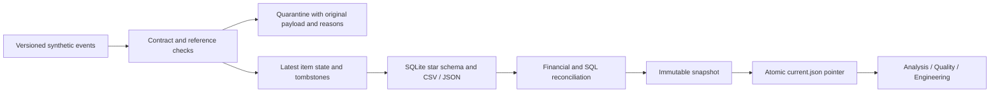

# Gabriel Costa — Data Analytics & Data Engineering

**Good decisions. Reliable data.** A bilingual portfolio with two equal entry paths: explore the analysis and inspect the engineering.

[Portfolio](https://gabrielcosta06.github.io/portfolio-data-analyst/) · [LinkedIn](https://www.linkedin.com/in/josegabriel-costa/) · [Commercial Intelligence](projects/commercial/) · [Brazil / CO₂](projects/brazil/)

Developed with AI assistance. Commercial fixtures are synthetic; no employer, client or employee data is included. The independent public-data case identifies its source, extraction date, scope and licenses. Portfolio content is available in Portuguese and English; language preference persists across the new pages.

## Commercial Intelligence

One data product, two connected investigations. Why can revenue rise while gross margin falls? How do late corrections, duplicates and invalid records affect the numbers?

- **Analysis:** net revenue, gross contribution, weighted margin, category/customer contribution, monthly trends, a revenue reconciliation, filters, shareable selections and CSV export. A discount/cost scenario demonstrates margin sensitivity with volume held constant.
- **Quality:** a browser experiment injects duplicates, negative cost and unknown customers into a three-item sample. It contrasts unchecked totals with quarantined output. Full Python quarantine and rule reasons are separately inspectable.
- **Engineering:** versioned events, customer/product dimensions, incremental item-state updates, stale-event handling, tombstones, idempotent replay, a local writer lock, SQL/export reconciliation and atomic publication of immutable snapshots. Failure/retry tests preserve every previous reader artifact.

The corrected fixture has **2,645 order items, 1,889 orders and 48 customers**, January–October 2026. Net revenue **BRL 7,204,974.50**; direct cost **4,245,635.04**; gross profit **2,959,339.46**. These are demonstration totals, not realized company impact. Order IDs and item IDs have different grains. Margin is weighted, never a sum of row percentages.

September/October mix, discounts and costs deliberately create a margin investigation. Associations and arithmetic scenarios are not causal estimates or forecasts. [Definitions, recommendations, decisions and limits](docs/commercial.md).

[Current snapshot pointer](data/commercial/current.json) · [Baseline/correction/replay evidence](data/commercial/demo-evidence.json) · [Pipeline](src/commercial.py) · [SQL](projects/commercial/analysis.sql) · [Tests](tests/test_commercial.py) · [Captioned screen recording](assets/walkthrough.webm)



## Independent public-data case

**What goes into the number?** Compare Brazil's annual CO₂ trends including/excluding land-use change, in total, per person or indexed to 2000. The 25-year 2000–2024 extract preserves source values and pins an upstream commit. Nulls are not imputed; there is no causal policy attribution.

Source: [Our World in Data CO₂ dataset](https://github.com/owid/co2-data), with Global Carbon Budget emissions and the population sources listed in the pinned codebook. This is an explicit historical snapshot of the GitHub dataset; the upstream repository now directs users to a new catalog for ongoing updates. It is not advertised as the latest live data. OWID-produced data is CC BY 4.0; underlying third-party terms apply as documented upstream.

[Raw extract](data/public/brazil.csv) · [Provenance and hashes](data/public/source.json) · [Validated JSON](data/public/brazil.json) · [Offline builder / explicit refresh](src/public_data.py)

## Reproduce and verify

Python **3.12+** for the complete site builder. Core pipelines and data validation require no external Python dependencies. Serve the repository root so ES modules and fetch requests work:

```sh
python -m unittest discover -s tests -v
python scripts/check_artifacts.py
python src/build_site.py
python src/build_powerbi.py
python -m http.server 8080
```

Open `http://127.0.0.1:8080`. There is no npm build, runtime API, tracker, login or secret. Fonts, icons, data and video are self-hosted. GitHub Pages serves the root unchanged.

Generate the new commercial demonstration into a **fresh** output directory, then replay its corrections:

```sh
python src/commercial.py --demo --output .local/demo
python src/commercial.py --source .local/demo/raw/corrections.json --dimensions .local/demo/raw/dimensions.json --output .local/demo
```

`--demo` refuses to replace an existing publication. Baseline → corrected → replay evidence is generated in that directory. The state is incrementally updated; SQLite is fully materialized from merged state. This is a local demonstration, not a source-CDC or distributed-warehouse performance claim. A forcibly terminated writer can leave a lock: confirm the recorded process is stopped before clearing it.

Public-data validation is offline by default:

```sh
python src/public_data.py
python src/public_data.py --refresh  # deliberately fetch and pin a new upstream snapshot
```

Optional browser verification (Chromium, with screenshots outside the repository):

```sh
python -m pip install playwright==1.65.1
python -m playwright install chromium
python scripts/browser_check.py
```

Checks cover exact filtered totals, distinct orders, exported CSV contents, selection persistence, scenario arithmetic, all quality experiments, replay evidence, SHA-256, bilingual navigation, desktop/tablet/mobile layouts, local links and load-failure recovery. `scripts/record_walkthrough.py` regenerates the silent recording; PT/EN captions are in `assets/`.

GitHub Actions runs unit tests, deterministic artifact comparisons, Power BI binding checks, browser verification and the existing Spark/Delta notebook execution. Browser captures and executed notebook evidence are uploaded as workflow artifacts. `.gitattributes` fixes text line endings for reproducible checks across Windows/Linux.

## Companion studies and their verified scope

These retain the original, separate **600-order** January–June 2026 fixture. Their totals differ from Commercial Intelligence.

| Companion | Evidence |
|---|---|
| [Python / SQLite pipeline](projects/pipeline/) | Schema checks, 670 input rows, 600 accepted, 70 quarantined; rerun and schema-drift tests |
| [Spark / Delta notebook](projects/pipeline/databricks/) | Self-contained Bronze/Silver/Gold notebook executed in CI with PySpark 4.0.1 and Delta Lake 4.0.1; [executed notebook](evidence/sales_lakehouse.executed.ipynb) and [JSON](evidence/spark-validation.json) |
| [Power BI](projects/analytics/powerbi/) | Corrected PBIP opened and M queries refreshed in Desktop on 2026-11-12; full and filtered DAX totals reconciled to fixture; [execution evidence](evidence/powerbi-validation.json) |

Power BI measures `Total Revenue` and `Total Cost` avoid the previous collision with column names. [Editable project source](projects/analytics/powerbi/project/) and [portable ZIP](start/PowerBI-pronto.zip) are provided. **Visual layout inspection remains pending:** the Windows session was locked and captures were rejected. Desktop opening, refresh and DAX execution are verified; no visual rendering or exported PBIX claim is made.

Execution inside a Databricks workspace remains separate from the successful local-Spark CI evidence. No cloud resources were provisioned. [Execution guide](start/).

## Résumé and assets

[Portuguese PDF](assets/cv/pt/jose_gabriel_cv.pdf) · [English PDF](assets/cv/en/jose_gabriel_cv.pdf). Editable Word versions are adjacent, with stable `jose_gabriel_cv` basenames. Supplied résumé content and contact details are preserved.

Code and generated synthetic fixtures: MIT. Public-data attribution/terms: `data/public/source.json` and upstream codebook. Fonts: bundled OFL notices in `assets/fonts/`. Bootstrap Icons 1.11.3: bundled MIT notice. [Design reference and decisions](docs/design/).

## Português

Portfólio bilíngue com análise de dados/BI e engenharia como públicos de igual importância. O projeto principal conecta decisões comerciais a dados reproduzíveis: filtros, cenários, quarentena, versões, replay, testes e publicação atômica. Um segundo estudo usa dados públicos do Brasil para mostrar como a definição do indicador altera a leitura da tendência.

Os estudos originais de Spark/Delta e Power BI são complementares e usam outra fixture. Os resultados do novo projeto são sintéticos, não impacto de empregador. Premissas, grão, limites e evidências ficam acessíveis junto de cada investigação.
