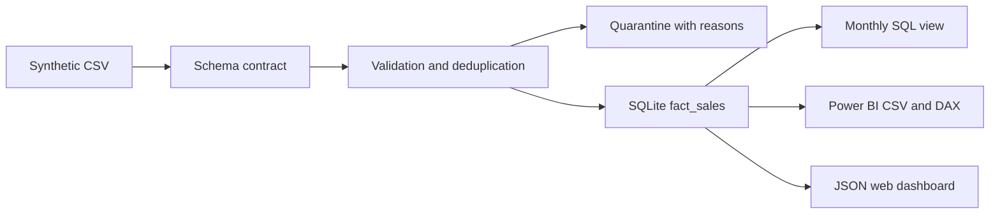

# Gabriel Costa | Data Engineer & Data Analyst

[Live portfolio](https://gabrielcosta06.github.io/portfolio-data-analyst/) · [LinkedIn](https://www.linkedin.com/in/josegabriel-costa/)

Six interactive case studies explore synthetic sales and payments alongside public CVM filings. Explore the verified Lakehouse run, inspect rejected rows, drill into sales and margin, and review locally executed results for the BigQuery query. Developed with AI assistance.

[Execution guide](start/) contains the next steps for running the notebook in Databricks and opening a prepared Power BI project, plus the official training links. The [portable Power BI ZIP](start/PowerBI-pronto.zip) contains an embedded synthetic fixture, two tables, one relationship, eight measures and ten PBIR visual definitions. Its 17 schema-bearing JSON documents passed the official Microsoft schemas; model bindings, fixture totals and chart bounds were checked.

## Homepage and recruiter experience

The responsive homepage highlights data engineering and analysis, leads with the Lakehouse pipeline and sales dashboard, and links directly to résumé downloads. Stack includes AWS and Microsoft Azure studies and the Google BigQuery case study. Experience summarizes Controlling roles at Baumer S.A. Project pages share the same styles, with mobile layouts for the sales dashboard filters, metrics and charts. A standard-library HTML integrity test checks homepage navigation, local links and image alternatives.

The homepage and project pages have static Brazilian Portuguese and [English](en/) versions. On an automatic entry, the browser asks [Country.is](https://country.is/) for the approximate country of its IP address, with no credentials or referrer. Brazil opens in Portuguese and other countries open in English. If the lookup fails or times out, the browser language determines the result. The site keeps the resulting language for the tab session and saves a manual PT/EN choice across visits. Direct English routes can also be shared, and the language links work with JavaScript disabled.

## Résumé downloads

The homepage includes a dedicated recruiter section at `#curriculo`, linked from the navigation and the hero. Both Portuguese and English unified résumés are available as PDF and editable Word downloads. Each document has one page.

Files use the requested stable basename `jose_gabriel_cv` in separate language directories:

- `assets/cv/pt/jose_gabriel_cv.pdf` and `assets/cv/pt/jose_gabriel_cv.docx`
- `assets/cv/en/jose_gabriel_cv.pdf` and `assets/cv/en/jose_gabriel_cv.docx`

Each link uses the corresponding HTML `download` filename. To update the résumé, replace the matching files while keeping these paths and filenames stable. The documents contain the professional contact details supplied for recruitment.

## Reproduce

Python 3.10+; local pipeline uses only the standard library.

```sh
python src/pipeline.py --generate
python -m unittest discover -s tests -v
python -m http.server 8080
```

Open http://localhost:8080. The CLI replaces only demonstration outputs in `data/processed`. The generated SQLite database is ignored by Git; CSV/JSON evidence is versioned. Use `--source` and `--output` for a separate local fixture/output directory.

## Projects

| Study | Implementation | Verified scope |
|---|---|---|
| [Payments reconciliation](projects/reconciliation/) | ERP, acquirer and bank reconciliation with row-level trace and an exception queue. | Three exceptions, full cash tie-out and integer-cent checks. |
| [CVM filing revision tracker](projects/cvm-filings/) | Archived consolidated DRE extracts, submission timelines and account-level diffs. | Three issuers compared for fiscal 2024. Each amount links to its archive and source row. |
| [Pipeline](projects/pipeline/) | Bronze to Gold lineage, plus a Delta Lake incremental load with a late order, a correction and an invalid record. | Local Python tests and Spark/Delta run in GitHub Actions. The page reconciles both sets of evidence. |
| [Sales analysis](projects/analytics/) | Filterable category ranking, a margin-gap investigation, month drill-down, CSV export and an editable Power BI package. | Dashboard and SQL verified. |
| [Data quality](projects/quality/) | Search and inspect the original values, source lines and rules for rejected records. | 670 evaluated, 600 accepted, 70 quarantined. |
| [BigQuery sales analysis](projects/bigquery/) | Typed CSV schema, monthly partitions, GoogleSQL and interactive monthly results. | Query translated to DuckDB and reconciled in CI. |

[Databricks notebook](projects/pipeline/databricks/sales_lakehouse.ipynb) is self-contained: synthetic fixture, Bronze/Silver/Gold, quarantine, Delta writes/readback, financial reconciliation and an idempotent rerun. It requires no uploaded CSV or Volume. The complete notebook passed in [GitHub Actions with PySpark 4.0.1 and Delta Lake 4.0.1](https://github.com/GabrielCosta06/portfolio-data-analyst/actions/runs/42510152023). See the [executed notebook](evidence/sales_lakehouse.executed.ipynb), [validation JSON](evidence/spark-validation.json) and [run instructions](projects/pipeline/databricks/README.md).

The Spark evidence comes from a GitHub-hosted runner. In Databricks, the notebook creates/replaces four demonstration Delta tables in `portfolio_gabriel_demo_20261108` in the current catalog; schema/table creation permission is required. AWS and Azure are study topics. The [BigQuery guide](projects/bigquery/README.md) shows how to load the demonstration data and run the analysis in a Google Cloud project.

## Incremental replay and the sales decision

The [incremental Lakehouse demo](projects/pipeline/#incremental-demo) starts from the same 600 accepted synthetic orders. It applies the [three change records](projects/pipeline/incremental_batch.csv) and rereads both Delta tables. A late order inserts, a newer revision corrects an existing order, and an invalid date is quarantined. The rerun preserves both tables' combined SHA-256 fingerprint. The fixture uses immutable batches and a single writer, with separate Delta transactions for orders and quarantine.

With the Spark setup from the [run guide](projects/pipeline/databricks/README.md), reproduce the results from the repository root:

```sh
python src/incremental_lakehouse.py --verify-delta --check
```

The [sales decision case](projects/analytics/#decision-case) compares the filtered dataset's leaders by revenue, gross profit and weighted margin. A category's investigation priority measures its gross profit gap if it reached the selection's weighted margin at unchanged revenue. The dashboard recalculates when the selection changes.

## Results and grain

One synthetic order line per OrderId, Jan–Jun 2026. Revenue BRL 728,800; direct cost BRL 420,300; gross profit BRL 308,500; weighted gross margin 42.33%. This is a demonstration, not employer impact. [Manifest](data/processed/manifest.json) includes source SHA-256 and rule counts. Money is integer cents in SQL and Decimal in validation. No taxes, freight, discounts or returns.

The generator intentionally adds 20 duplicate rows and 50 invalid rows (five groups of 10). The raw CSV has 670 rows. CSV/JSON exports derive only from accepted records. Rejected rows and reasons are retained in [quarantine](data/processed/quarantine.csv).

## Architecture



## Limits

Small full-refresh demonstration. CDC, incremental state, scheduling, cloud deployment and cross-layer transaction recovery are outside the scope of the case studies. A syntactically valid row can still be wrong in business terms. Source freshness/completeness and master-data integrity need additional contracts. Python/SQL and Spark results are reconciled against the bundled synthetic fixture; arbitrary production inputs have not been validated.

## Publish and validate

GitHub Pages serves the repository root. The workflow runs unit tests, regenerates pipeline data to detect drift, reconciles the translated GoogleSQL query in DuckDB, and executes every notebook code cell with Spark/Delta. The checked-in `evidence/` snapshot records run 42510152023; newer executions are downloadable as workflow artifacts. `.nojekyll` prevents Jekyll processing. No runtime secrets, account forms or analytics trackers.

License: MIT for code and generated synthetic fixtures. CVM extracts and derived comparisons use the [Open Database License 1.0](https://opendatacommons.org/licenses/odbl/1-0/). Public professional summary reflects information supplied by Gabriel.
