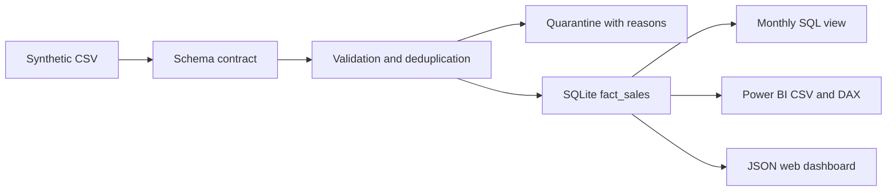

# Gabriel Costa — Data Analytics & Data Engineering

[Live portfolio](https://gabrielcosta06.github.io/portfolio-data-analyst/) · [LinkedIn](https://www.linkedin.com/in/josegabriel-costa/)

Three inspectable case studies: a Python/SQL pipeline, a sales analysis with a web dashboard and Power BI companion, and data-quality controls. Developed with AI assistance. All sample data is synthetic; no Baumer, TOTVS, client or employee data is included.

[Execution guide](start/) contains the next steps for running the notebook in Databricks and opening a prepared Power BI project, plus the official training links. The [portable Power BI ZIP](start/PowerBI-pronto.zip) contains an embedded synthetic fixture, two tables, one relationship, eight measures and ten PBIR visual definitions. Its 17 schema-bearing JSON documents passed the official Microsoft schemas; model bindings, fixture totals and chart bounds were checked. **Power BI Desktop opening, M/DAX execution and rendering remain unverified.** This package is preparation, not an executed PBIX.

## Reproduce

Python 3.10+; local pipeline uses only the standard library.

```sh
python src/pipeline.py --generate
python -m unittest discover -s tests -v
python -m http.server 8080
```

Open http://localhost:8080. The CLI replaces only demonstration outputs in `data/processed`. The generated SQLite database is ignored by Git; CSV/JSON evidence is versioned. Use `--source` and `--output` for a separate local fixture/output directory.

## Projects

| Study | Implementation | Verified scope |
|---|---|---|
| [Pipeline](projects/pipeline/) | Python, CSV contract, SQLite warehouse, monthly SQL view, deterministic exports | Executed locally; rerun and schema-drift tests |
| [Sales analysis](projects/analytics/) | SQL window functions, filterable web dashboard, CSV export, Power Query M and DAX | SQL and web dashboard verified; Power BI Desktop not executed |
| [Data quality](projects/quality/) | Row-level quarantine with reasons, uniqueness/domain/financial checks | 670 input rows; 600 accepted; 70 quarantined |

[Databricks notebook](projects/pipeline/databricks/sales_lakehouse.ipynb) is self-contained: synthetic fixture, Bronze/Silver/Gold, quarantine, Delta writes/readback, financial reconciliation and an idempotent rerun. It requires no uploaded CSV or Volume. The complete notebook passed in [GitHub Actions with PySpark 4.0.1 and Delta Lake 4.0.1](https://github.com/GabrielCosta06/portfolio-data-analyst/actions/runs/42510152023). See the [executed notebook](evidence/sales_lakehouse.executed.ipynb), [validation JSON](evidence/spark-validation.json) and [run instructions](projects/pipeline/databricks/README.md).

Execution **inside a Databricks workspace is pending**. CI uses local Spark on a GitHub-hosted runner. In Databricks, the notebook creates/replaces four demonstration Delta tables in `portfolio_gabriel_demo_20261108` in the current catalog; schema/table creation permission is required. AWS/Azure resources were not provisioned.

## Results and grain

One synthetic order line per OrderId, Jan–Jun 2026. Revenue BRL 728,800; direct cost BRL 420,300; gross profit BRL 308,500; weighted gross margin 42.33%. This is a demonstration, not employer impact. [Manifest](data/processed/manifest.json) includes source SHA-256 and rule counts. Money is integer cents in SQL and Decimal in validation. No taxes, freight, discounts or returns.

The generator intentionally adds 20 duplicate rows and 50 invalid rows (five groups of 10). The raw CSV has 670 rows. CSV/JSON exports derive only from accepted records. Rejected rows and reasons are retained in [quarantine](data/processed/quarantine.csv).

## Architecture



## Limits

Small full-refresh demonstration. No CDC, incremental state, scheduler, cloud infrastructure or cross-layer transaction recovery. A syntactically valid row can still be wrong in business terms. Source freshness/completeness and master-data integrity need additional contracts. Python/SQL and Spark results are reconciled against the bundled synthetic fixture; arbitrary production inputs have not been validated.

## Publish and validate

GitHub Pages serves the repository root. The workflow runs unit tests, regenerates evidence to detect drift, and executes every notebook code cell with Spark/Delta. The checked-in `evidence/` snapshot records run 42510152023; newer executions are downloadable as workflow artifacts. `.nojekyll` prevents Jekyll processing. No runtime secrets, account forms or analytics trackers.

License: MIT for code and generated synthetic fixtures. Public professional summary reflects information supplied by Gabriel.
