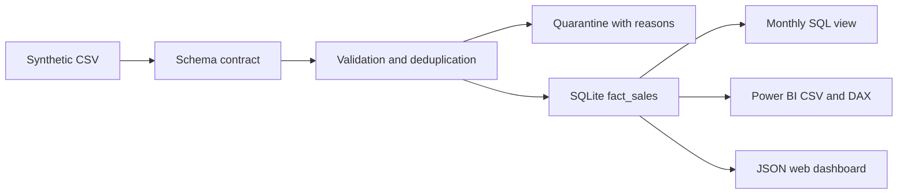

# Gabriel Costa — Data Analytics & Data Engineering

[Live portfolio](https://gabrielcosta06.github.io/portfolio-data-analyst/) · [LinkedIn](https://www.linkedin.com/in/josegabriel-costa/)

Three inspectable case studies: a Python/SQL pipeline, a sales analysis with a web dashboard and Power BI companion, and data-quality controls. Developed with AI assistance. All sample data is synthetic; no Baumer, TOTVS, client or employee data is included.

## Reproduce

Python 3.10+; local pipeline uses only the standard library.

```sh
python src/pipeline.py --generate
python -m unittest discover -s tests -v
python -m http.server 8080
```

Open http://localhost:8080. The CLI replaces only demonstration outputs in `data/processed`. The generated SQLite database is ignored by Git; CSV/JSON evidence is versioned. Use `--source` and `--output` for a separate local fixture/output directory.

## Projects

| Study | Implementation | Verified scope |
|---|---|---|
| [Pipeline](projects/pipeline/) | Python, CSV contract, SQLite warehouse, monthly SQL view, deterministic exports | Executed locally; rerun and schema-drift tests |
| [Sales analysis](projects/analytics/) | SQL window functions, filterable web dashboard, CSV export, Power Query M and DAX | SQL and web dashboard verified; Power BI Desktop not executed |
| [Data quality](projects/quality/) | Row-level quarantine with reasons, uniqueness/domain/financial checks | 670 input rows; 600 accepted; 70 quarantined |

[Databricks companion](projects/pipeline/databricks/sales_lakehouse.py) demonstrates Bronze/Silver/Gold with PySpark and Delta. It has not been executed in Databricks. Requires an existing Unity Catalog Volume. AWS/Azure resources were not provisioned.

## Results and grain

One synthetic order line per OrderId, Jan–Jun 2026. Revenue BRL 728,800; direct cost BRL 420,300; gross profit BRL 308,500; weighted gross margin 42.33%. This is a demonstration, not employer impact. [Manifest](data/processed/manifest.json) includes source SHA-256 and rule counts. Money is integer cents in SQL and Decimal in validation. No taxes, freight, discounts or returns.

The generator intentionally adds 20 duplicate rows and 50 invalid rows (five groups of 10). The raw CSV has 670 rows. CSV/JSON exports derive only from accepted records. Rejected rows and reasons are retained in [quarantine](data/processed/quarantine.csv).

## Architecture



## Limits

Local in-memory full refresh. No CDC, incremental state, scheduler, cloud infrastructure or cross-file transaction recovery. A syntactically valid row can still be wrong in business terms. Source freshness/completeness and master-data integrity need additional contracts. The Databricks companion has documented rounding/deduplication differences for inputs other than the bundled fixture.

## Publish and validate

GitHub Pages serves the repository root. The workflow runs unit tests and regenerates evidence to detect drift. `.nojekyll` prevents Jekyll processing. No runtime secrets, account forms or analytics trackers.

License: MIT for code and generated synthetic fixtures. Public professional summary reflects information supplied by Gabriel.
